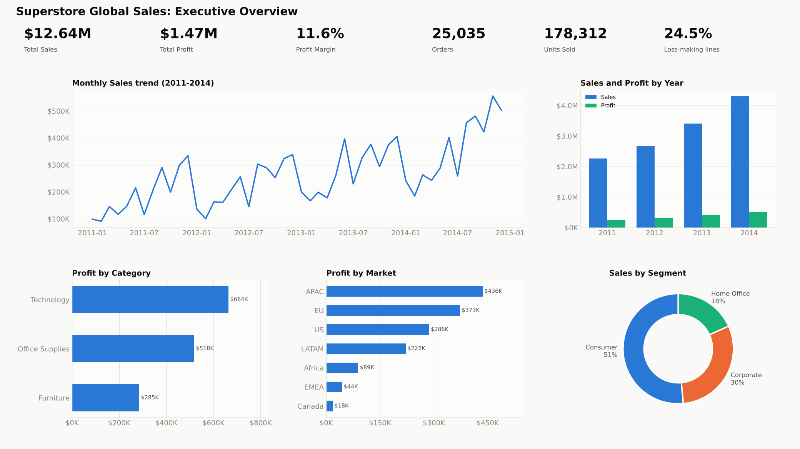
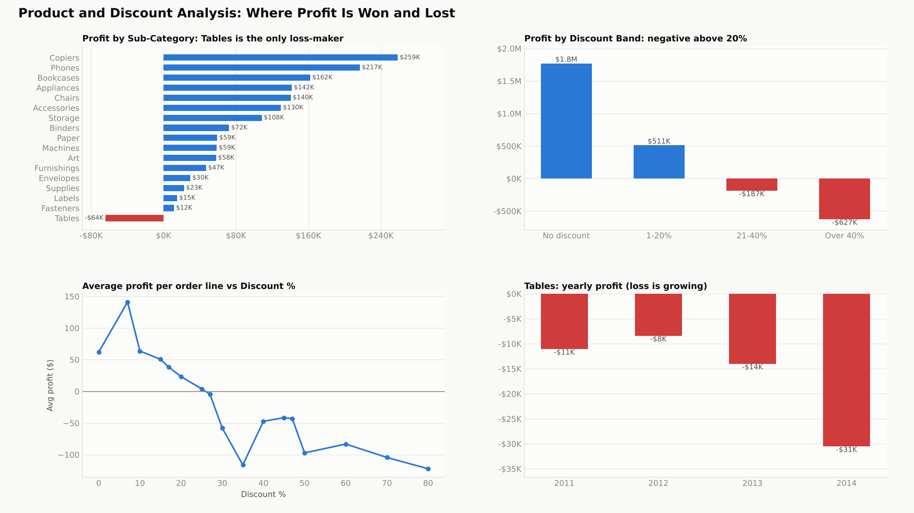
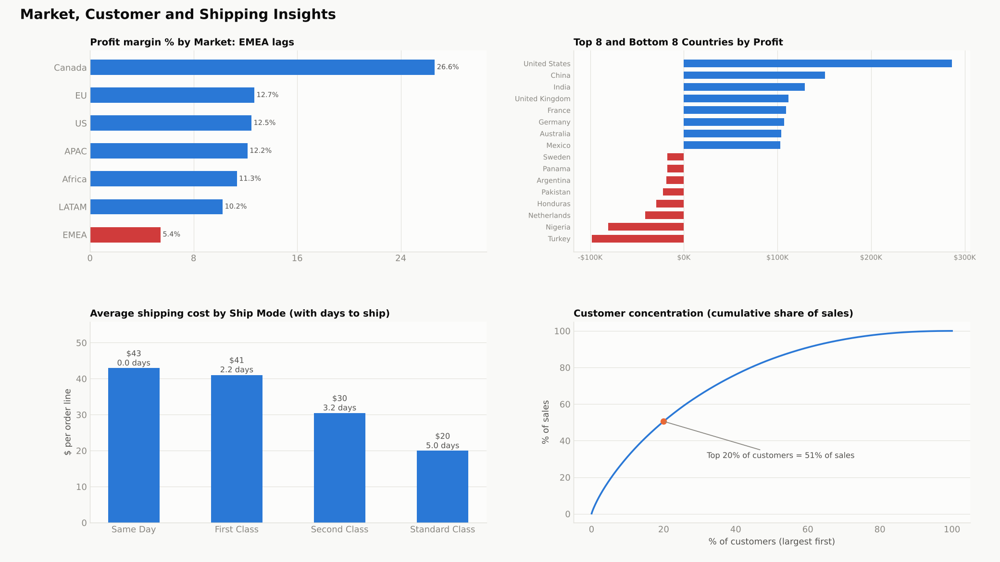

# Superstore Sales: Data Visualization Dashboard

Task 3 of my data analytics internship. A three-page sales dashboard built from the Superstore dataset (51,290 order lines, 2011 to 2014).

## Dashboard pages
| Page | Question it answers |
|---|---|
| 1. Executive Overview | How are sales and profit trending, and where do they come from? |
| 2. Product and Discount | Which products lose money, and what do discounts do to profit? |
| 3. Market, Customer and Shipping | Which markets and countries underperform, and what does shipping cost? |

## Files
| File | Purpose |
|---|---|
| `superstore_clean.csv` | Cleaned dataset (51,290 rows) used by the dashboard |
| `dax_measures.txt` | DAX date table and all measures (sales, profit, margin, YoY, loss lines and more) |
| `dashboard_build_guide.docx` | Page layouts, visual settings and the data story |
| `interactive_dashboard.html` | Interactive version with Year, Market, Segment and Category filters. Open in any browser |
| `screenshots/` | Dashboard page images |

## Data story
1. **Growth is real.** Sales rose from $2.26M to $4.30M (+90%) between 2011 and 2014.
2. **Margin is stuck** at about 11 to 12%, so growth came from volume, not efficiency.
3. **Discounts are the leak.** No-discount lines earn a 25% margin; above 20% discount about 90% of lines lose money, costing about $815K.
4. **Tables** (-$64K) and **EMEA** (5.4% margin) stand out as problem areas.
5. **Recommendation:** cap discounts at 20%, fix Table pricing, review EMEA and loss-making countries such as Turkey and Nigeria.

## Tools
Power BI (DAX), Python (Matplotlib) for previews, HTML and Chart.js for the interactive version.
